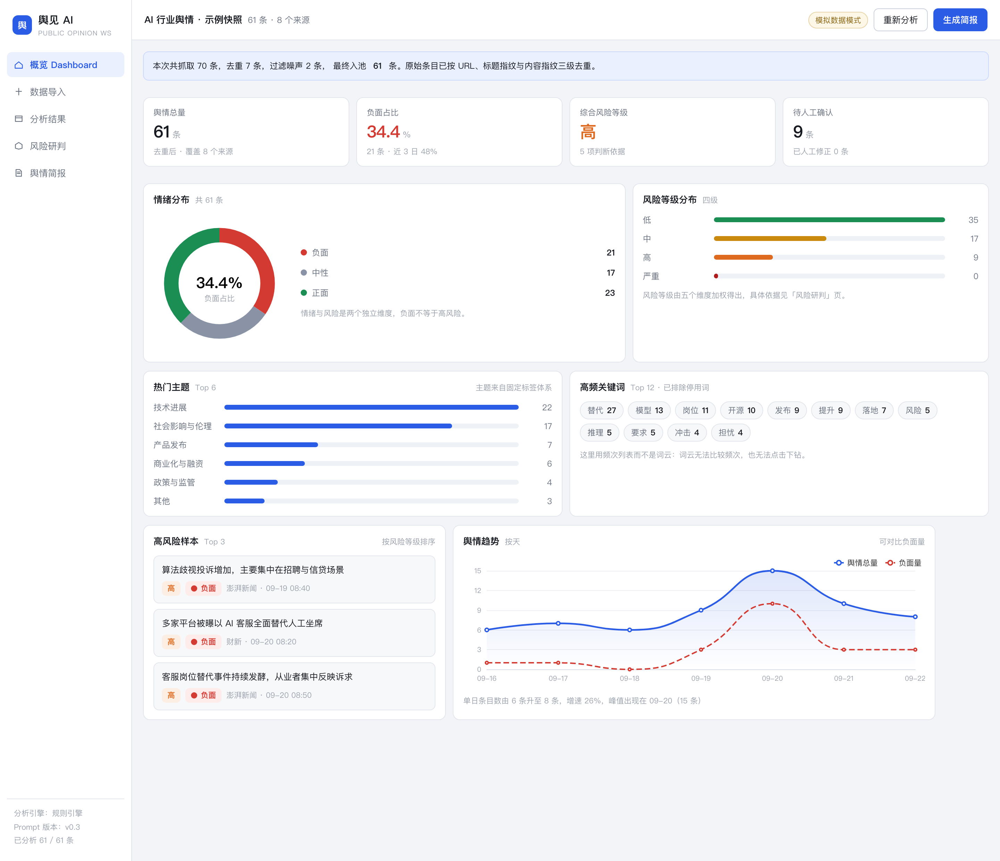
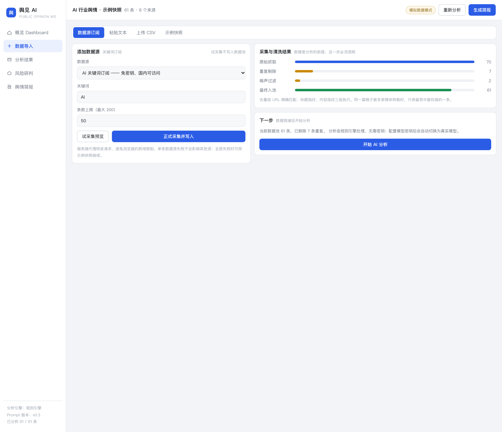
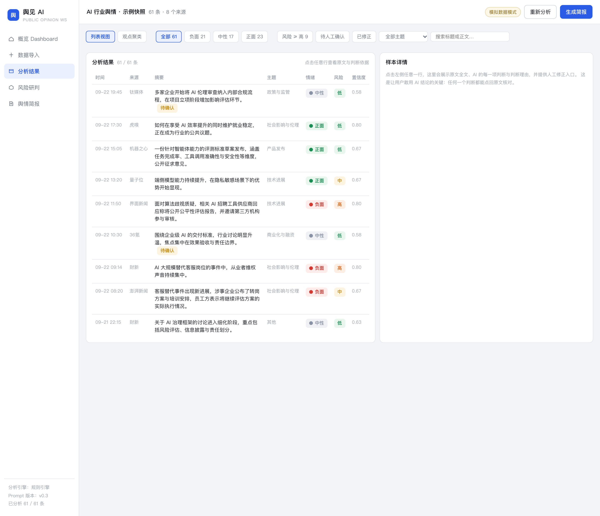
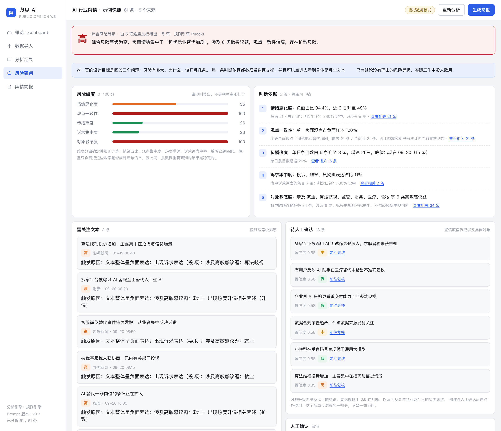
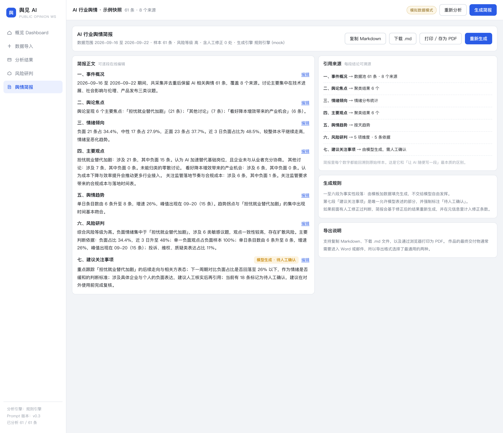

# 舆见 AI · Public Opinion AI Workspace

**面向舆情与公关从业者的 AI 舆情分析工作台。**

把「读文本 → 分类 → 判情绪 → 找观点 → 评风险 → 写简报」这条每天 2–3 小时的人工流水线，
压缩成「导入数据 → 审核 AI 判断 → 一键出简报」。

`AI 产品经理作品集` · `可运行 Demo` · `5 个页面` · `61 条示例数据` · `40+ 项测试断言`

---

## 界面预览

> 五张图对应一条完整业务闭环：看态势 → 导数据 → 查细节 → 判风险 → 出简报。

| 概览 Dashboard | 数据导入 |
| --- | --- |
|  |  |

| 分析结果 | 风险研判 |
| --- | --- |
|  |  |



---

## 一、为什么做这个

舆情从业者每天的真实工作流是：手动刷各平台 → 复制进 Excel → 逐条读 → 判断正负 →
挑出要汇报的几条 → 写简报。每天 2–3 小时，而且不同人的判断口径不一致，事后无法复盘。

真正稀缺的不是「再多一个 AI 工具」，而是**一条能压掉重复劳动、同时让人敢为结论负责的流水线**。

所以我做的不是聊天框，而是一个工作台：

- 左侧是可统计、可下钻的结构化结果
- 右侧是原文与判断依据
- 中间是一条从数据到简报的确定性流程

**我的角色**：独立完成产品定位、功能设计、数据结构与 JSON Schema、Prompt 设计、
前端与接口实现、端到端测试与迭代。

**产品边界（明确不做）**——把边界写清楚，比把功能列表写长更能体现判断力：

- 不做全网爬虫采集，起点是「你手上已经有一批文本」
- 不做实时监控与告警推送
- 不做舆情处置与对外口径审批
- 不做多租户与权限体系

---

## 二、三个关键产品决策

### 决策一：不做聊天框，做工作台

聊天框在舆情场景里有四个硬伤：

| 问题 | 后果 |
| --- | --- |
| 一次只能吃几条文本 | 上百条评论无法批量处理 |
| 输出是自然段落 | 无法汇总、无法排序、无法出图表 |
| 结论不可追溯 | 回答不了「这个判断来自哪几条文本」 |
| 每次结果不一致 | 无法复盘，也无法交给别人复核 |

所以产品形态选择 **「分析流水线 + 人工复核」**：确定性流程负责搬运和统计，人负责判断和拍板。

### 决策二：风险研判的输入是统计指标，不是原始文本

> 让模型读一堆文本「拍脑袋判风险」，结果不可控、不可复现、不可解释，还很贵。

正确做法是：系统先用**确定性规则**算出五个维度的分数，模型只负责把算好的数字
翻译成判断与表述。因此每一条判断依据都天然带着数据支撑，并且可以点回到具体样本。

| 维度 | 判定口径 | 权重 |
| --- | --- | --- |
| 情绪恶化度 | 负面占比 > 40% 记中，> 60% 记高 | 0.28 |
| 观点一致性 | 单一负面观点占负面样本比例 | 0.22 |
| 传播热度 | 单日条目数增速 | 0.20 |
| 诉求集中度 | 投诉、维权、质疑类表达占比 | 0.15 |
| 对象敏感度 | 命中敏感议题标签数量 | 0.15 |

加权分 ≥ 75 为「严重」，≥ 55 为「高」，≥ 32 为「中」。

这条决策直接回答了面试里最常被追问的问题：**你凭什么相信 AI 给出的风险等级？**

### 决策三：AI 给建议，人做决定

所有 AI 判断都可以被人工覆盖，覆盖后 Dashboard、聚类、风险研判、简报**全部重算**，
并记录原值、新值与修正时间。

这不只是体验设计：修正记录本身会沉淀成一份 AI 标注质量的评测数据集。

---

## 三、产品能力地图

| 模块 | 位置 | 说明 |
| --- | --- | --- |
| 数据源订阅 | `app/input` + `app/api/source` | 关键词订阅 / RSS / 示例快照，含「试采集预览」 |
| 数据清洗 | `lib/clean.ts` | 去重 → 噪声过滤 → 时间标准化 → 正文提取 |
| 单条 AI 分析 | `lib/analysis.ts` | 情绪 / 主题 / 观点 / 关键词 / 风险 / 依据 |
| 指标口径 | `lib/stats.ts` | Dashboard 上每个数字都只在这里定义一次 |
| 观点聚类 | `lib/analysis.ts` | 3–6 个主要观点，含样本数、情绪分布、代表文本 |
| 风险研判 | `lib/rules.ts` + `lib/analysis.ts` | 5 个维度打分 + 可下钻的判断依据 |
| 舆情简报 | `lib/analysis.ts` | 七段式，事实段落只做数据填充 |
| 人工修正 | `lib/store.tsx` | 覆盖任意 AI 判断，全站数据自动重算 |

### 五个页面

1. **概览 Dashboard** — 5 秒内知道整体态势
2. **数据导入** — 数据源订阅 / 粘贴文本 / 上传 CSV / 示例快照
3. **分析结果** — 列表视图 + 观点聚类视图 + 详情抽屉
4. **风险研判** — 综合等级 + 判断依据 + 需关注清单 + 待人工确认
5. **舆情简报** — 七段式成品，每段可溯源

### 双模式运行

| 模式 | 触发条件 | 行为 |
| --- | --- | --- |
| 规则引擎 (mock) | 未配置 `LLM_API_KEY` | 本地规则打分 + 模板生成，零网络依赖，结果确定 |
| 真实模型 | 配置了 `LLM_API_KEY` | 走兼容 OpenAI 协议的接口，结构化输出 + Schema 校验 + 失败重试 |

顶部栏常驻显示当前模式。**宁可显得朴素，也不让演示产生误导。**

---

## 四、AI 输出为结构化 JSON

**不让模型返回一段自然语言。** 所有分析结果都经过 JSON Schema 校验后前端才渲染。

单条分析的核心结构（完整定义见 `lib/schema.ts`）：

```json
{
  "sentiment": "negative",
  "sentiment_confidence": 0.91,
  "topic": "社会影响与伦理",
  "topic_confidence": 0.88,
  "summary": "……",
  "keywords": ["AI 客服", "就业替代", "维权"],
  "opinion": "认为企业在未充分协商的情况下用 AI 替代人工岗位",
  "risk_level": "critical",
  "risk_reasons": ["……"],
  "evidence_quotes": ["……"],
  "need_human_review": false
}
```

三条**由程序强制校验**的跨字段规则（不依赖模型自觉）：

1. `risk_level` 非 `low` 时，`risk_reasons` 至少 1 条
2. `evidence_quotes` 中每一项都必须是**原文的子串**，否则丢弃并降低置信度 —— 这是防编造的关键约束
3. 情绪为正面/中性但风险为高时，必须给出原因，否则降级

主题分类采用**固定 8 类标签体系**，不允许模型自创。
否则同一批数据会出现「大模型 / 大语言模型 / AI 模型」三个标签，统计直接失效。

---

## 五、一个容易被忽略的工程细节：去重

`lib/clean.ts` 按固定顺序执行四道清洗：

1. **去重** — 链接精确 → 标题指纹 → 内容指纹，三级比对
2. **噪声过滤** — 广告、抽奖、导航页、过短文本
3. **时间标准化** — 多格式解析；解析失败用采集时间兜底并标记 `timeKnown: false`
4. **正文提取** — 剥离 HTML 标签

顺序不能反。**同一篇稿子被十家媒体转载，不去重会让「热门主题」和「情绪占比」全部失真**，
而这恰恰是最容易被漏掉、也最容易被追问的一点。

示例快照的实际效果：原始 70 条 → 去重 7 条 → 噪声 2 条 → **入池 61 条**。

---

## 六、测试

端到端验证脚本覆盖：数据清洗 → 批量分析 → Schema 校验 → 确定性校验 →
指标口径 → 观点聚类 → 风险研判 → 简报生成，共 40+ 项断言。

```bash
npm test
```

重点断言：

- 所有分析结果通过 JSON Schema 校验
- `evidence_quotes` 全部可在原文中找到（防编造）
- 同一输入重复分析结果完全一致（确定性）
- 情绪/风险/主题分布计数之和等于总量
- 风险判断依据 ≥ 3 条，且每条都含具体数字、都能下钻到真实样本
- 简报为七段式，事实性段落均带引用

---

## 七、已知限制

- **不做真实平台抓取**：仅支持公开 RSS 与关键词订阅，不做页面破解、不绕过反爬、不抓取平台用户评论
- **情绪判断在反讽、谐音、网络黑话上不可靠**：低于置信度阈值的条目会被自动标记为「待人工确认」
- **风险等级跨批次不可比**：判定口径固定，但不同数据集之间不宜直接比较绝对分数
- **聚类结果存在波动**：真实模型模式下同一批数据两次聚类可能不同，界面上已明示并提供重新聚类
- **规则引擎是简化的**：mock 模式用于保证 Demo 可复现，不代表真实模型效果

---

## 八、产品原则

1. **AI 给建议，人做决定** —— 所有判断可覆盖，并记录谁改了什么
2. **结论必须有依据** —— 没有数据支撑就不输出，宁可说「数据不足」
3. **结构化优先** —— 能进表格的绝不用段落
4. **不定义无法解释的等级** —— 风险等级必须捆绑可读的触发原因
5. **先跑通一条完整链路，再谈广度** —— 宁可 5 个功能都完整，不要 15 个半成品

---

## 九、本地运行

需要 Node.js 18 或以上。

```bash
pnpm install     # 或 npm install
pnpm dev         # http://localhost:3000
```

生产模式：

```bash
pnpm build && pnpm start
```

**无需任何 API Key 即可完整运行。** 未配置密钥时自动进入「规则引擎 (mock)」模式，
五个页面、完整分析链路、简报生成全部可用，且结果**完全确定性**（同样的输入永远得到同样的输出），
保证演示不会翻车。

接入真实模型：复制 `.env.example` 为 `.env`，填入密钥。

```bash
LLM_API_KEY=sk-xxx
LLM_BASE_URL=https://api.openai.com/v1
LLM_MODEL=gpt-4o-mini
LLM_CONCURRENCY=4
CONFIDENCE_THRESHOLD=0.6
```

### 目录结构

```
yujian-ai/
├── app/                     页面与接口
│   ├── page.tsx             概览 Dashboard
│   ├── input/page.tsx       数据导入
│   ├── analysis/page.tsx    分析结果
│   ├── risk/page.tsx        风险研判
│   ├── report/page.tsx      舆情简报
│   └── api/                 source / ingest / analyze / cluster / risk / report
├── components/              外壳、图表、详情抽屉、基础组件
├── data/snapshot.ts         AI 行业舆情示例快照
├── lib/
│   ├── types.ts             全部数据实体定义
│   ├── schema.ts            JSON Schema 与校验
│   ├── prompts.ts           P1–P4 四组 Prompt
│   ├── rules.ts             确定性规则引擎（情绪/主题/风险维度）
│   ├── analysis.ts          分析编排、聚类、研判、简报
│   ├── clean.ts             清洗与去重
│   ├── stats.ts             指标口径
│   ├── llm.ts               模型适配与重试
│   └── store.tsx            全局状态与流程编排
└── start.command            双击启动（macOS）
```

### 双击启动（macOS，可选）

不想用命令行的话，双击 `start.command`，然后打开 http://localhost:3000。

其余三个脚本用于本地演示：

| 文件 | 作用 |
| --- | --- |
| `演示模式.command` | 生产构建，页面秒开，适合演示 |
| `停止服务.command` | 释放 3000 端口 |
| `share.command` | 用 Cloudflare Tunnel 生成临时公网地址，手机也能打开 |

> 隧道地址是公开的，且分享期间电脑必须保持开机。演示数据无所谓，不要放真实敏感数据。

---

## 十、这个 Demo 不是什么

这是一个用于展示 AI 产品经理能力的作品，不是商业产品。
它验证的是「一条从原始文本到可发布简报的链路能否被 AI 显著加速」，
不验证大规模并发、多租户权限、真实平台数据接入等商业化能力。
